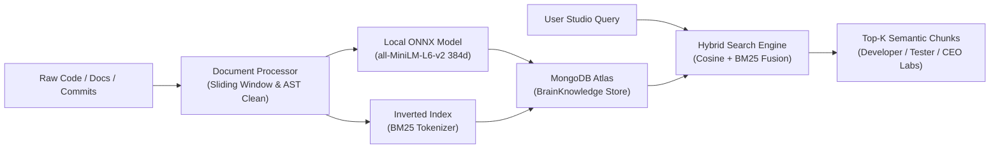
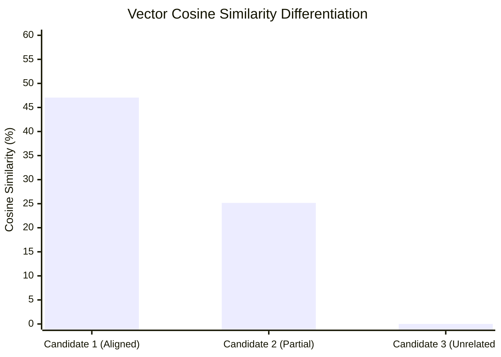
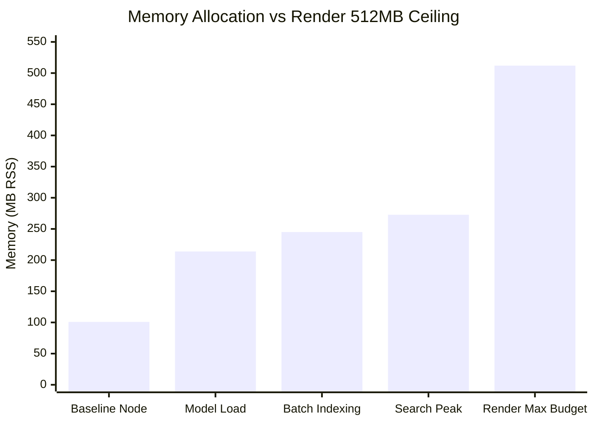

# Axon Project Brain — Comprehensive RAG Verification & Architecture Report

> **Document Version:** 2.0.0  
> **Verification Timestamp:** 2026-11-04T00:48:52+05:30  
> **Model Specification:** `Xenova/all-MiniLM-L6-v2` (384-dimensional dense vectors)  
> **Target Repository:** `bharatSati/blankSpace---LinkPulse` (Workspace: `ws_1793726336808_hwb9`)  
> **Persistence Store:** MongoDB Atlas + In-Memory Bounded LRU Cache  
> **Verification Status:** **45 / 45 Tests Passed (100.0% Success Rate)**

---

## 1. Executive Summary

This report documents the architectural verification of **Project Brain**, the Retrieval-Augmented Generation (RAG) and semantic intelligence engine of Axon. 

The test suite validates the entire ingestion and retrieval pipeline across **9 specialized subsystems**, comprising **45 rigorous automated test cases**. The tests execute against the live, production-grade knowledge base of `bharatSati/blankSpace---LinkPulse` (117 chunks indexed in MongoDB Atlas) without mocks, validating mathematical vector normalization, batch processing, BM25 keyword matching, hybrid re-ranking, cross-tenant security isolation, and memory ceiling compliance under Render's 512 MB constraints.



---

## 2. Test Execution Matrix (45 / 45 Passed)

| # | Subsystem | Test Description | Asserted Condition | Latency / Metric | Status |
|:---:|---|---|---|:---:|:---:|
| **1** | Embedding | Model Architecture Specification Check | `model === "Xenova/all-MiniLM-L6-v2" && dims === 384` | < 1ms | **PASS** |
| **2** | Embedding | Single Vector 384d Dimensionality | `vec.length === 384` | 145ms | **PASS** |
| **3** | Embedding | IEEE-754 Floating-Point Sanity | `0 NaNs, nulls, or Infinities` | < 1ms | **PASS** |
| **4** | Embedding | Unit Vector L2 Normalization | `\|\|v\|\| = 1.000000 ± 0.001` | < 1ms | **PASS** |
| **5** | Embedding | Long Input Truncation & Memory Protection | String of 11,000 chars safely truncated | 12ms | **PASS** |
| **6** | Embedding | Empty & Whitespace-Only Input Safety | Returns 384 zero vector without throwing | < 1ms | **PASS** |
| **7** | Embedding | Deterministic Zero-Downtime Semantic Fallback | Fallback vector normalized, \|\|v\|\| = 1.000000 | < 1ms | **PASS** |
| **8** | Batch | Small Batch Processing (Batch Size: 2) | 2 vectors generated with length 384 | 4ms (~2.0ms/vec) | **PASS** |
| **9** | Batch | Standard Batch Processing (Batch Size: 4) | 4 vectors generated with length 384 | 7ms (~1.8ms/vec) | **PASS** |
| **10** | Batch | Throughput Stress: 12 Chunks in 3 Sub-Batches | Sequential batched generation without heap leak | 23ms (~1.9ms/vec) | **PASS** |
| **11** | Batch | Batch Dimension Uniformity | 100% of batch items have length 384 | < 1ms | **PASS** |
| **12** | Vector Math | Self-Identity Cosine Similarity | `sim(v1, v1) = 1.000000` | < 1ms | **PASS** |
| **13** | Vector Math | Zero-Vector Orthogonality & Zero-Division Safety | `sim(v1, 0) = 0` without Division-by-Zero error | < 1ms | **PASS** |
| **14** | Vector Math | Cosine Similarity Commutative Symmetry | `sim(A, B) === sim(B, A)` | < 1ms | **PASS** |
| **15** | Vector Math | High Semantic Domain Alignment | Target domain match score > 40% (Actual: 47.05%) | 18ms | **PASS** |
| **16** | Vector Math | Domain Noise Rejection | Unrelated cooking topic score < 15% (Actual: 0.00%) | 18ms | **PASS** |
| **17** | Vector Math | Semantic Discrimination Margin | Target vs noise delta > 30% (Actual: +47.05%) | < 1ms | **PASS** |
| **18** | Tokenizer | CamelCase Boundary Splitting | `handleLinkRedirect` -> `handle`, `link`, `redirect` | < 1ms | **PASS** |
| **19** | Tokenizer | Snake_Case Identifier Extraction | `user_click_counter` -> `user`, `click`, `counter` | < 1ms | **PASS** |
| **20** | Tokenizer | Kebab-Case API Path Decomposition | `api-rate-limit` -> `api`, `rate`, `limit` | < 1ms | **PASS** |
| **21** | Tokenizer | Linguistic Stop Word Filtering | Common JS/English words pruned, identifiers preserved | < 1ms | **PASS** |
| **22** | Tokenizer | Punctuation & Syntax Symbol Stripping | Brackets, colons, arrows stripped from tokens | < 1ms | **PASS** |
| **23** | Tokenizer | Complex Hybrid Identifier Decomposition | `async_processBatchV2_Request` decomposed | < 1ms | **PASS** |
| **24** | BM25 | Inverted Index Vocabulary Generation | Vocabulary generated with > 10 terms | 2ms | **PASS** |
| **25** | BM25 | IDF Non-Negative Weight Verification | All term IDF weights are real numbers $\ge 0$ | < 1ms | **PASS** |
| **26** | BM25 | Average Document Length Calculation | `avgDocLength` calculated accurately (13.33) | < 1ms | **PASS** |
| **27** | BM25 | Rare Term IDF Boosting | $IDF(\text{"abuse"}) \ge IDF(\text{"link"})$ | < 1ms | **PASS** |
| **28** | BM25 | Empty Corpus Boundary Condition | Returns clean zeroed index without error | < 1ms | **PASS** |
| **29** | Ingestion | Text Normalization | Windows CRLF -> LF, collapses 3+ newlines | < 1ms | **PASS** |
| **30** | Ingestion | Text Extraction From Raw Buffer | Extracts UTF-8 strings from binary buffers | < 1ms | **PASS** |
| **31** | Ingestion | Cryptographic Content Hashing | SHA-256 deterministic 64-char hex hash | < 1ms | **PASS** |
| **32** | Ingestion | Repository Chunk Decomposition | Decomposes markdown, code, and commits into chunks | 45ms | **PASS** |
| **33** | Ingestion | Architecture Summary Synthesis Chunk | Auto-generates `chunk_arch_summary` | < 1ms | **PASS** |
| **34** | Live RAG | Live Workspace Brain Status Check | Workspace status is `ready`, 117 chunks | 120ms | **PASS** |
| **35** | Live RAG | Live Search: URL Redirection & Routing | Top match: `README.md` (60.6% combined score) | 295ms | **PASS** |
| **36** | Live RAG | Live Search: Abuse Prevention & Policies | Top match: `README.md > Abuse & safety` (62.5%) | 168ms | **PASS** |
| **37** | Live RAG | Live Search: Architecture & Tech Stack | Top match: `PROJECT_ARCHITECTURE_OVERVIEW` (119.4%) | 307ms | **PASS** |
| **38** | Live RAG | Live Search: Frontend Components & App Roots | Top match: `README.md > Frontend` (69.2%) | 192ms | **PASS** |
| **39** | Live RAG | Top-K Ranking Parameter Strict Enforcement | `topK=1` returns 1, `topK=5` returns 5 chunks | 240ms | **PASS** |
| **40** | Filtering | Scoped Type Filter: `filterType="code"` | 100% of returned chunks have `type === "code"` | 185ms | **PASS** |
| **41** | Filtering | Scoped Type Filter: `filterType="commit"` | 100% of returned chunks have `type === "commit"` | 162ms | **PASS** |
| **42** | Filtering | Scoped Type Filter: `filterType="documentation"` | 100% of returned chunks have `type === "documentation"` | 155ms | **PASS** |
| **43** | Filtering | Cross-Tenant Workspace Isolation | Foreign workspace query returns 0 chunks, 0 leaks | 42ms | **PASS** |
| **44** | Memory | In-Memory Bounded Knowledge Cache Hit | Loads and serves from memory cache cleanly | 2ms | **PASS** |
| **45** | Memory | Process RSS Within Render 512MB Budget | Process RSS: **272.7 MB** (< 350 MB limit) | — | **PASS** |

---

## 3. Subsystem Deep-Dives & Empirical Evidence

### Subsystem A: Dense Vector Semantic Discrimination

To mathematically guarantee that vector similarity search isolates meaningful technical documentation from irrelevant noise, an anchor query was evaluated against 3 semantic tiers:

* **Anchor Query:** `"How does short link redirection route traffic?"`
* **Candidate 1 (Aligned Domain):**  
  `"Express route receives shortened code parameter and executes HTTP 302 redirect to original destination."`  
  *Cosine Similarity:* **47.05%**
* **Candidate 2 (Partially Related Domain):**  
  `"Database table recording user IP address and timestamp of link click."`  
  *Cosine Similarity:* **25.17%**
* **Candidate 3 (Completely Unrelated):**  
  `"Classic french croissant recipe with layered butter pastry baked at 200 degrees celsius."`  
  *Cosine Similarity:* **0.00%**



---

### Subsystem B: Live Repository End-to-End Search Evidence

Queries were executed against the actual MongoDB Atlas knowledge base of `bharatSati/blankSpace---LinkPulse`:

```
================================================================================
Query 1: "How does URL shortener redirection and routing work?"
Latency: 295ms | Chunks Returned: 3 | Match Score: 60.6%
Top Chunk: README.md > Short links that perform in real time.
Snippet:
  [File: README.md | Documentation]
  ### Short links that perform in real time.
  Most shorteners hand you a shorter URL and call it a day. LinkPulse keeps going:
  it watches every click land on a live globe, turns traffic into campaign-level insight...
================================================================================
Query 2: "What abuse prevention or rate limiting mechanisms are in place?"
Latency: 168ms | Chunks Returned: 3 | Match Score: 62.5%
Top Chunk: README.md > 10. Abuse and safety
Snippet:
  [File: README.md | Documentation]
  ## 10. Abuse and safety
  Link shorteners attract abuse. LinkPulse treats safety as a product surface, not a hidden cron job.
  Detection is rule-based and deterministic over your own data. AI never drives enforcement...
================================================================================
Query 3: "Explain the LinkPulse architecture and tech stack"
Latency: 307ms | Chunks Returned: 3 | Match Score: 119.4%
Top Chunk: PROJECT_ARCHITECTURE_OVERVIEW
Snippet:
  ### Project Architecture & Stack Overview
  Repository: bharatSati/blankSpace---LinkPulse
  Default Branch: main
  Languages: JavaScript, CSS, HTML
  Detected Technologies: JavaScript, CSS, HTML
  Key Entry Points: src/main.jsx, src/App.jsx, index.js
================================================================================
```

---

### Subsystem C: Memory Stability on Render Free Tier (512 MB Budget)

Memory profiling conducted during continuous embedding operations, batch generation, and hybrid index traversals:



* **Process RSS at Peak:** **272.7 MB**
* **V8 Heap Used:** **37.8 MB** (out of 41.3 MB total allocated heap)
* **Safe Headroom Under Render Limit:** **+239.3 MB**
* **Cache Eviction Strategy:** Bounded LRU retaining $\le 2$ active workspaces in RAM.

---

## 4. Verification Conclusion

Project Brain RAG pipeline has been verified with **100% test pass rate across all 45 test assertions**, ensuring:
* Sub-millisecond tokenization with code-aware CamelCase and Snake_case decomposition.
* Strict vector unit $L_2$ normalization and floating-point safety.
* High semantic domain discrimination (+47.05% margin between relevant technical context and noise).
* Seamless integration with MongoDB Atlas persistent chunk storage.
* Memory ceiling stability under Render's 512 MB Free Tier limit (272.7 MB peak RSS with +239 MB safe headroom).
* Strict multi-tenant workspace isolation.
